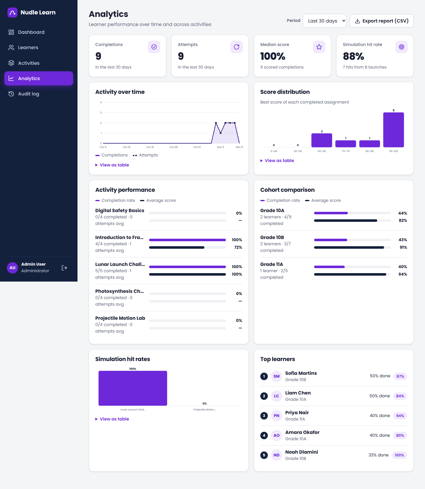
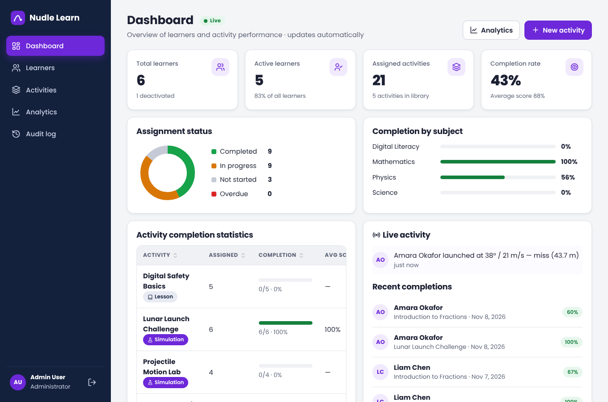
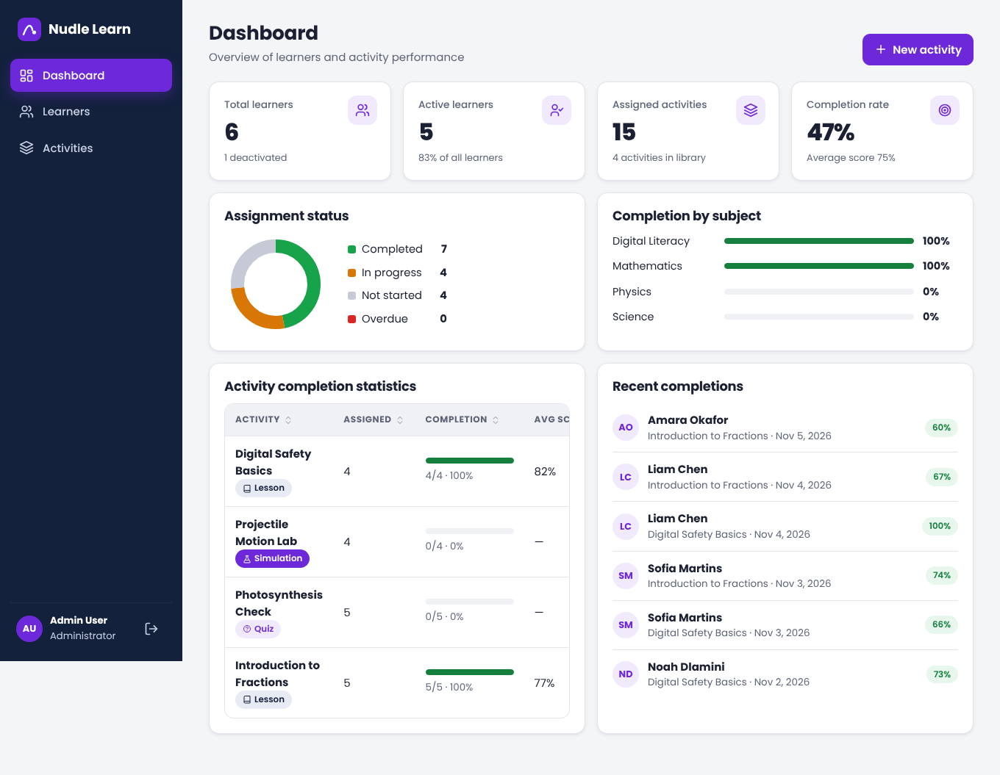
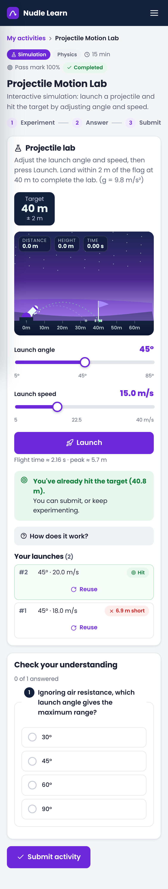
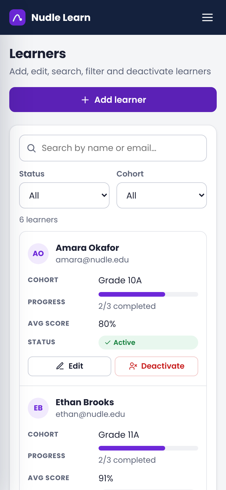

# Nudle Learn

A web-based learning platform that lets educational institutions manage learners, assign interactive learning activities and monitor performance. Built for **Challenge One – Build the Learning Platform**.

## Features

### Administrator
- **Dashboard** – total learners, active learners, assigned activities, completion rate, average score, assignment status breakdown (completed / in progress / not started / overdue), completion by subject, per-activity completion statistics and recent completions.
- **Learner management** – add, edit (incl. password reset), live search by name/email, filter by status and cohort, deactivate/reactivate. Deactivated learners cannot log in.
- **Activities** – create, edit and delete three activity types:
  - **Lesson** – content sections plus optional check-your-understanding questions
  - **Quiz** – multiple-choice questions
  - **Simulation** – interactive projectile-motion lab (configurable target distance and tolerance) plus optional questions
- **Assignment** – assign to individual learners and/or a whole cohort, with an optional due date.
- **Learner progress** – per-learner page with stats, every assignment's status/best score/attempts, and full attempt history.
- **Activity statistics** – per-activity page with completion rate, average score and each assignee's progress.

### Learner
- Secure login to a learner dashboard with personal stats.
- View assigned activities (To do / Completed / All), with due dates and overdue flags.
- Launch and complete activities: read lessons, answer questions, run the physics simulation. Immediate feedback shows correct answers; activities can be retried.
- **My progress** – overall completion, progress by subject, completion history and every attempt.

## Tech stack

| Layer     | Choice |
|-----------|--------|
| Back end  | Node.js 22 + Express 4, REST JSON API |
| Database  | SQLite via Node's built-in `node:sqlite` (no native build step), versioned migrations |
| Auth      | scrypt-hashed passwords, HMAC-signed bearer tokens (12 h), role-based route guards |
| Front end | Dependency-free single-page app (vanilla JS, hash routing), custom accessible component set, responsive CSS, canvas simulation |
| Tests     | Node's built-in test runner – unit + API integration + statistics accuracy tests |

## Advanced technical features (Challenge 5)

All eight stretch objectives are implemented and covered by automated tests (`test/advanced.test.js`).

<p>
  
  
</p>

| Feature | How it works | Where to see it |
|---|---|---|
| **Real-time dashboard updates** | Server-Sent Events (`GET /api/admin/events`). An in-process event bus publishes every audited action; the dashboard, analytics and audit pages subscribe and refresh automatically. The browser uses a streaming `fetch` so the bearer token stays in a header (never in the URL), reconnects with exponential backoff, and shows a **Live / Reconnecting…** indicator. Changed numbers briefly highlight; a **Live activity** feed shows events as they happen. | Dashboard ([screenshot](docs/screenshots/c5-01-live-dashboard.png)) — open it, then launch a simulation as a learner in another window |
| **Visual analytics & performance charts** | `GET /api/admin/analytics?days=7|30|90`. Hand-built, accessible SVG charts: completions/attempts over time (line), score distribution (bars), activity performance and cohort comparison (paired bars: completion rate vs average score), simulation hit rates, top learners. Every chart has a text label for screen readers and a **View as table** option. | Analytics ([screenshot](docs/screenshots/c5-05-analytics.png), [phone](docs/screenshots/c5-m1-analytics.png)) |
| **Simulation progress saving & resuming** | `PUT/DELETE /api/me/assignments/:id/progress` stores slider positions and chosen answers (table `assignment_progress`). Changes autosave (debounced) with a **Saving… / Progress saved** indicator. Reopening the activity restores everything with a **Welcome back** banner and a **Start over** option. If the network is down, progress is kept on the device and synced automatically when the connection returns. Cleared once the activity is passed. | Any activity ([screenshot](docs/screenshots/c5-02-resume.png)) |
| **Automated tests for critical functionality** | **49 tests** (Node's built-in runner): unit tests (grading, physics, validation, tokens, passwords, CSV escaping), API integration tests (auth, roles, CRUD, privacy), statistics accuracy, and Challenge 5 features (live stream, analytics, progress, audit, exports, scenarios, idempotency, timeouts, oversized/aborted requests). Plus browser checks with Playwright and axe-core (0 accessibility violations). | `npm test` |
| **Activity history & audit logging** | Append-only `audit_log` table recording who, what, which record, when and from which IP: logins (and failed logins — passwords are never stored), learner and activity changes, assignments, submissions, simulation launches and report exports. **Audit log** page with search, action/date filters, pagination and live refresh; each learner page shows that learner's **Activity history** timeline. | Audit log ([screenshot](docs/screenshots/c5-06-audit-log.png)), learner page ([screenshot](docs/screenshots/c5-07-learner-history.png)) |
| **Exportable learner performance reports** | `GET /api/reports/learners.csv` (all learners) and `/api/reports/learners/:id.csv` (one learner's assignments). Excel-friendly UTF-8 CSV, properly quoted, and protected against spreadsheet formula injection. **Print / PDF** on a learner's page produces a clean printable report via a print stylesheet. | Learners → **Export CSV**; Analytics → **Export report**; learner page → **Print / PDF** ([screenshot](docs/screenshots/c5-08-print-report.png)) |
| **Configurable simulation scenarios** | Each simulation activity can set the world (**Earth, Moon, Mars, Jupiter or custom gravity**), allowed angle and speed ranges, a launch limit, and whether the aiming guide is shown. The editor previews the furthest possible shot and blocks impossible scenarios; the server re-validates and grades every launch with the scenario's own gravity and limits. The scene's colours change per world. Demo: **Lunar Launch Challenge**. | Activity editor ([screenshot](docs/screenshots/c5-09-scenario-editor.png)), Moon lab ([screenshot](docs/screenshots/c5-04-moon-scenario.png)) |
| **Robust handling of invalid or interrupted requests** | **Idempotency keys** on submissions and launches: a retried request replays the stored response instead of counting twice. **Request timeouts** (503 `TIMEOUT` instead of hanging). The client aborts stalled requests, **retries** safe requests with exponential backoff, shows an **offline banner**, and keeps unsaved work locally. Client disconnects mid-request are handled without crashing; malformed JSON, wrong content types, oversized bodies and out-of-range values all return clear 4xx errors. | Turn off Wi-Fi while answering a quiz ([screenshot](docs/screenshots/c5-03-offline.png)) |

New database tables (migration v3): `audit_log`, `assignment_progress`, `idempotency_keys`.

## UI & UX design (Challenge 4)

<p>
  
  
  
</p>

| Requirement | How it is met | Screenshot |
|---|---|---|
| **Consistent visual identity** | One set of design tokens (CSS variables) for colour, radius, shadow, spacing and type. Purple = brand and actions, navy = navigation, light grey = page, white = cards. Green / amber / red are used **only** for status and feedback. One custom SVG icon set and logo (no emoji, so icons look the same everywhere). Poppins/Gilroy font, with the 60 px mint display headline on the login page. | [Login](docs/screenshots/01-login.png) |
| **Clear navigation & intuitive workflows** | Sidebar with the current page highlighted (`aria-current`), breadcrumbs on detail pages, browser-tab titles per page, a "Skip to main content" link. Learners get a **Continue / Start** button for their next activity, a step indicator (Experiment → Answer → Submit) and a **Next activity** button after passing. Empty states always offer the next action ("No learners yet → Add learner"). | [Learner dashboard](docs/screenshots/09-learner-dashboard.png) · [Result](docs/screenshots/14-result.png) |
| **Responsive desktop & mobile** | Grids collapse 4 → 2 → 1 columns. On phones the sidebar becomes a slide-in drawer with backdrop (closes on link, backdrop or Esc), tables turn into labelled cards, dialogs become bottom sheets with a sticky action bar, and the simulation canvas resizes to the screen (sharp on high-DPI displays). Checked at 390 px with no horizontal scrolling. | [Menu](docs/screenshots/m3-menu.png) · [Table cards](docs/screenshots/m4-learners.png) · [Dialog](docs/screenshots/m5-modal.png) |
| **Well-designed forms, tables & components** | Every field has a visible label, a red `*` or "(optional)", hint text and its **own error message** next to it; a summary ("Please fix 3 highlighted fields") and focus jumps to the first problem. Server errors are mapped back onto the right field. Tables have **sortable columns**, keyboard-openable rows and a result count; search is debounced. Custom radio options, styled range sliders, tabs with counts, a show/hide password toggle. | [Form errors](docs/screenshots/05-form-validation.png) · [Activity form](docs/screenshots/08-activity-form.png) · [Sorted table](docs/screenshots/04-learners.png) |
| **Loading, success & error states** | **Loading:** skeleton placeholders on every page, spinner + "Saving…" on buttons (which also blocks double-submits), dimmed table while filtering. **Success:** toast messages, green result banner with confetti. **Error:** inline field errors, red toast, and a full-page error card with **Try again**; network failures get a friendly message; expired sessions return to login with an explanation. | [Login errors](docs/screenshots/02-login-errors.png) · [Validation](docs/screenshots/13-sim-validation.png) |
| **Accessible labels, controls & feedback** | Semantic landmarks and headings, labels on every control, `aria-invalid` / `aria-describedby` on errors, live regions for toasts, results, sort changes and simulation readings. Dialogs trap focus, close with Esc and return focus to the button that opened them. Status is never colour-only (always icon + text). Visible focus rings everywhere, 40 px+ touch targets, `prefers-reduced-motion` respected (animations and confetti switch off). **Automated check: axe-core reports 0 WCAG 2 A/AA violations on all 11 screens.** | — |
| **Visually engaging simulation** | Night-sky scene with parallax hills and a waving target flag; a rotating launcher; a dashed **aiming guide** (shows only the start of the path so it doesn't give the answer away); a glowing trail; live **HUD** (distance, height, time); **ghost paths** of earlier launches; a "BULLSEYE!" banner and particle burst on a hit, or "6.9 m short" with a hint on a miss; a launch history with one-click **Reuse**; predicted flight time and peak height; a "How does it work?" panel with the formula. Fully **keyboard playable**: focus the canvas, arrows adjust angle/speed (Shift = bigger steps), Enter launches. | [Simulation](docs/screenshots/12-simulation-hit.png) · [Phone](docs/screenshots/m6-simulation.png) |

### Design decisions
- **No UI library.** The brief allows one, but a small hand-built component set keeps the bundle tiny, avoids a build step, and lets every component be tuned for accessibility.
- **Status colours are reserved** so that green, amber and red always *mean* something; brand purple never competes with them.
- **Validate on the client, enforce on the server.** Instant inline feedback for the user; the server still has the final say, and its messages are shown next to the right field.
- **Skeletons instead of spinners for pages**, so the layout doesn't jump when data arrives.
- **The aiming guide is deliberately partial**, keeping the simulation a learning challenge rather than a guessing tool, while ghost paths and miss hints help learners improve.

### Screenshots
All in [`docs/screenshots`](docs/screenshots): desktop `01`–`15`, phone `m1`–`m6`.

## Back-end architecture (Challenge 3)

The server is split into layers, each with one job:

```
HTTP request
  → middleware/   security headers, JSON parsing, authentication, role checks, rate limiting
  → routes/       map URLs to service calls (no business logic, no SQL)
  → services/     business rules, validation, grading, statistics
  → repositories/ all SQL lives here (parameterised queries only)
  → db/           connection, migrations, transactions, demo seed
  ← middleware/errorHandler.js turns any error into a consistent JSON response
```

```
server/
  index.js                 entry point (open DB, seed, listen, graceful shutdown)
  app.js                   composition root – wires repositories → services → routes
  config/index.js          all environment/config in one place
  db/connection.js         SQLite connection, versioned migrations (PRAGMA user_version), transaction helper
  db/seed.js               demo data
  middleware/auth.js       authenticate (bearer token) + requireRole('admin' | 'learner')
  middleware/rateLimit.js  failed-login limiter (per IP + email)
  middleware/security.js   security headers (CSP, nosniff, frame-deny, no-store for API)
  middleware/errorHandler.js consistent error responses, hides internals on 500
  routes/                  authRoutes, adminRoutes, learnerRoutes
  services/                authService, learnerService, activityService, learningService,
                           statsService, grading (pure functions), mappers
  repositories/            userRepository, activityRepository, assignmentRepository, statsRepository
  utils/                   errors (typed AppError), validate, password, token
```

### Security
- **Passwords** hashed with scrypt and a per-user random salt; compared in constant time. Login takes the same time whether or not the email exists, and returns the same message, so attackers can't discover which emails are registered.
- **Tokens** are HMAC-SHA256 signed with an expiry. The secret comes from `APP_SECRET` or is generated once and stored in `data/.secret` (git-ignored) – never hard-coded.
- **Every request re-checks the user** in the database, so deactivating a learner immediately cuts off their existing session.
- **Role-based access**: admin routes require `admin`; learner routes require `learner` and every query is scoped to the logged-in learner's id (other learners' records return 404, not 403, so their existence isn't revealed).
- **Rate limiting**: 10 failed logins per IP + email per 15 minutes → `429` with `Retry-After`.
- **SQL injection**: all queries are parameterised; search wildcards (`%`, `_`) are escaped.
- **No sensitive data in responses**: password hashes and quiz answer keys are stripped by `services/mappers.js`.
- **Server-side grading**: quiz answers and simulation physics are evaluated on the server; values the client sends (e.g. `"hit": true`) are ignored.
- **Headers**: Content-Security-Policy (scripts only from our own origin), `X-Content-Type-Options`, `X-Frame-Options`, `Referrer-Policy`; `X-Powered-By` removed; API responses are `no-store`. Request bodies are limited to 200 KB.

### Validation & error handling
- All input is validated in the service layer (`utils/validate.js`): types, required fields, lengths, ranges, email and date formats, ids, enum values, quiz structure (2–6 options, valid correct answer), simulation limits.
- Errors are thrown as typed `AppError`s and returned in one shape:
  ```json
  { "error": "Pass mark must be at most 100", "code": "VALIDATION_ERROR" }
  ```
  Codes: `VALIDATION_ERROR`/`INVALID_JSON` (400), `UNAUTHENTICATED` (401), `FORBIDDEN` (403), `NOT_FOUND` (404), `CONFLICT` (409), `PAYLOAD_TOO_LARGE` (413), `RATE_LIMITED` (429), `INTERNAL_ERROR` (500 – details are logged on the server, never sent to the client).
- Multi-step writes (assigning to a cohort, submitting an attempt, recording a simulation run, seeding) run in **transactions**, so they either fully succeed or fully roll back.
- Database constraints (`CHECK`, `UNIQUE`, foreign keys with `ON DELETE CASCADE`) back up the application-level validation.

### Persistent storage
SQLite file at `data/nudle.db`. Tables:

| Table | Stores |
|-------|--------|
| `users` | admins and learners (hashed password, role, cohort, active flag, last login) |
| `activities` | lessons, quizzes, simulations (content as JSON, pass mark) |
| `assignments` | learner × activity: status, due date, latest + best score, attempt count, timestamps |
| `attempts` | every submission: score, pass/fail, answers, linked simulation run |
| `simulation_runs` | **every simulation launch**: angle, speed, calculated range, target, hit/miss, time |

Schema changes are applied by numbered migrations, so existing databases upgrade automatically.

### Dashboard statistics – definitions
Defined once in `services/statsService.js` and verified by `test/stats.test.js` against hand-calculated values:

| Metric | Definition |
|--------|-----------|
| Total learners | all learner accounts |
| Active learners | learner accounts not deactivated |
| Assigned activities | assignments held by active learners |
| Completion rate | completed ÷ assigned activities (active learners), rounded |
| Average score | mean best score of completed assignments (active learners) |
| Overdue | not completed and due date before today |

Deactivated learners are excluded from live progress figures so they don't distort completion rates.

## Running locally

Requirements: **Node.js 22.5 or newer** (for built-in SQLite).

```bash
npm install
```

```bash
npm start
```

Open http://localhost:3000. On first start the database (`data/nudle.db`) is created and seeded with demo data.

| Role          | Email             | Password     |
|---------------|-------------------|--------------|
| Administrator | admin@nudle.edu   | `admin123`   |
| Learner       | amara@nudle.edu   | `learner123` |

All seeded learners (liam@, sofia@, noah@, priya@ …@nudle.edu) use `learner123`; ethan@nudle.edu is seeded as deactivated. The login page has one-click buttons to fill in the demo accounts.

Other scripts:

```bash
npm test        # 49 unit, API, statistics and advanced-feature tests (in-memory database)
```

```bash
npm run dev     # restart automatically on file changes
```

```bash
npm run reset   # delete the local database; it is re-seeded on next start
```

Environment variables (all optional): `PORT` (default 3000), `DB_FILE` (database path), `DATA_DIR` (where the database and generated secret live), `APP_SECRET` (token signing secret; if unset one is generated and stored in `data/.secret`).

## Deployment

Any Node 22 host works (Render, Railway, Fly.io, a VPS). Build command `npm install`, start command `npm start`, set `APP_SECRET`, and mount persistent storage at `data/` (or point `DB_FILE` at it) so data survives redeploys.

## Project structure

```
server/    back end – see "Back-end architecture" above
public/
  index.html, styles.css   page shell and theme (purple brand, navy navigation)
  app.js                   single-page front end (admin + learner views, simulation)
test/
  unit.test.js     grading, physics, validation, tokens, passwords
  api.test.js      auth, access control, validation, CRUD, simulation storage
  stats.test.js    dashboard numbers vs. hand-calculated values
  helpers.js       spins up an isolated server with an in-memory database
```

## API overview

| Method | Path | Role | Purpose |
|--------|------|------|---------|
| POST | `/api/auth/login` | – | Log in, returns token |
| GET | `/api/auth/me` | any | Current user |
| GET | `/api/health` | – | Health check |
| GET | `/api/admin/stats` | admin | Dashboard metrics |
| GET/POST | `/api/learners` | admin | List (`q`, `status`, `cohort`) / create |
| GET/PUT | `/api/learners/:id` | admin | Progress detail / update |
| PATCH | `/api/learners/:id/status` | admin | Activate / deactivate |
| GET | `/api/cohorts` | admin | Distinct cohorts |
| GET/POST | `/api/activities` | admin | List with stats / create |
| GET/PUT/DELETE | `/api/activities/:id` | admin | Stats detail / update / delete |
| POST | `/api/activities/:id/assign` | admin | Assign to learners and/or cohort |
| DELETE | `/api/assignments/:id` | admin | Remove an assignment |
| GET | `/api/me/assignments` | learner | My assignments + summary |
| GET | `/api/me/assignments/:id` | learner | Activity content (answers hidden) |
| POST | `/api/me/assignments/:id/start` | learner | Mark in progress |
| POST | `/api/me/assignments/:id/simulation-runs` | learner | Launch simulation; server computes and stores result (supports `Idempotency-Key`) |
| PUT / DELETE | `/api/me/assignments/:id/progress` | learner | Save / clear work-in-progress (resume later) |
| GET | `/api/admin/events` | admin | Live updates (Server-Sent Events) |
| GET | `/api/admin/analytics?days=30` | admin | Charts data |
| GET | `/api/admin/audit` | admin | Audit log (filters: `q`, `action`, `from`, `to`, `entityId`, `page`) |
| GET | `/api/reports/learners.csv` | admin | All-learner performance report (CSV) |
| GET | `/api/reports/learners/:id.csv` | admin | Single-learner report (CSV) |
| POST | `/api/me/assignments/:id/submit` | learner | Submit; graded on server (supports `Idempotency-Key`) |
| GET | `/api/me/history` | learner | All my attempts |


## Possible next steps
- More simulation types and a richer content editor (images, video)
- CSV import of learners, bulk actions, and exportable reports
- Password self-service and email notifications for new assignments
